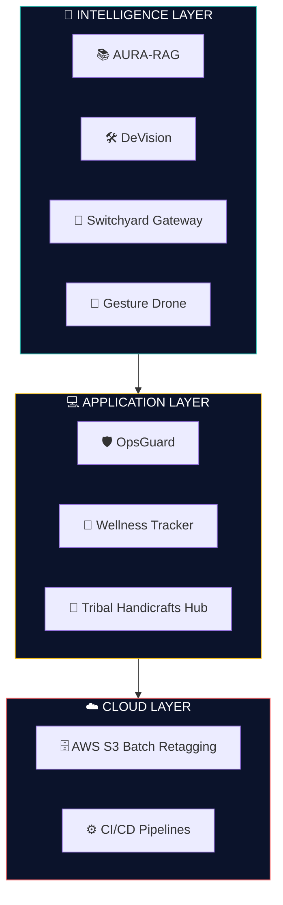
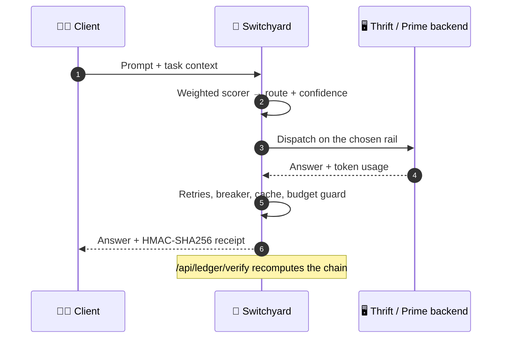
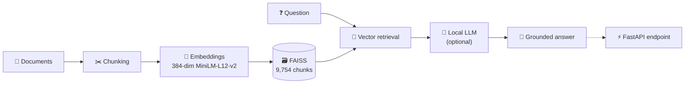
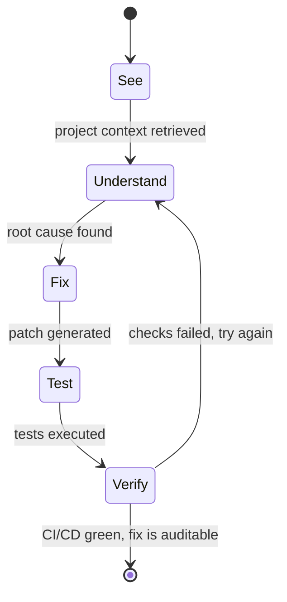
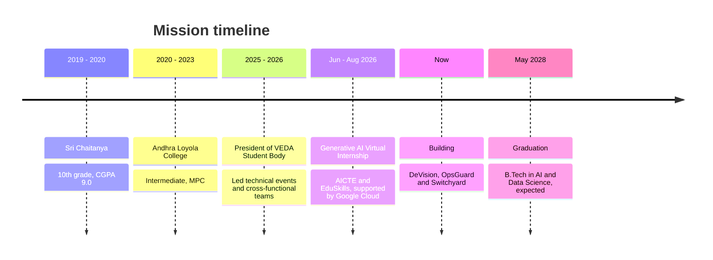

<p align="center">
  
</p>

<p align="center">
  
</p>

<p align="center">
  
  
  
  
</p>

<p align="center">
  <a href="https://monishratan-portfolio.netlify.app/"></a>
  <a href="https://www.linkedin.com/in/monish-ratan-259695247/"></a>
  <a href="mailto:monish03905@gmail.com"></a>
  <a href="https://leetcode.com/u/KL2400080018/"></a>
  <a href="https://www.codechef.com/users/monish_ratan"></a>
</p>

---

## 📡 TELEMETRY

<table>
<tr>
<td align="center" width="20%"><h1>8.34</h1><b>CGPA</b><br/><sub>B.Tech AI & DS</sub></td>
<td align="center" width="20%"><h1>9,754</h1><b>CHUNKS</b><br/><sub>indexed in FAISS</sub></td>
<td align="center" width="20%"><h1>6-DOF</h1><b>DRONE</b><br/><sub>flown by hand gestures</sub></td>
<td align="center" width="20%"><h1>8</h1><b>FLAGSHIP BUILDS</b><br/><sub>3 live, 26 public repos</sub></td>
<td align="center" width="20%"><h1>5</h1><b>CERTS</b><br/><sub>cloud & AI</sub></td>
</tr>
</table>

---

## 🌐 PORTFOLIO

<p align="center">
  <a href="https://monishratan-portfolio.netlify.app/">
    
  </a>
</p>

<p align="center"><i>"I build AI systems that see, retrieve, and verify."</i><br/>RAG pipelines · computer vision · full-stack software</p>

| 👁️ **See** | 🔎 **Retrieve** | ✅ **Verify** |
|---|---|---|
| Computer vision: gesture-controlled drone with OpenCV and MediaPipe | Multilingual RAG: 9,754 chunks in FAISS, served by FastAPI | Code repair with real test runs: DeVision's five-stage loop |

---

## 🧑‍🚀 OPERATOR PROFILE

```text
┌──────────────────────────────────────────────────────────────────┐
│  OPERATOR   Seelam Monish Ratan                                  │
│  CLASS      AI & Data Science undergraduate · KL University      │
│  ETA        Graduation, May 2028                                 │
│  CREED      I learn by building. I want AI that takes part in    │
│             real engineering work, not just chat answers.        │
│  PAST ROLE  President, VEDA Student Body (2025-26)               │
│  ACTIVE     DeVision · OpsGuard · Switchyard LLM Gateway         │
│  LEARNING   AI agents · RAG · system design · AWS · CI/CD        │
│  SEEKING    AI/ML · software engineering · full-stack internship │
│  PORTFOLIO  monishratan-portfolio.netlify.app                    │
└──────────────────────────────────────────────────────────────────┘
```

---

## 🛰️ SYSTEM MAP

Everything I build sits on one of three layers.



---

## 🚀 ACTIVE MODULES

<table>
<tr>
<td width="33%" valign="top">

### 🚉 Switchyard
**LLM Gateway & Router**

Routes each request to a cheap or a strong model, explains the decision, and writes a tamper-evident receipt.


[📦 Repository](https://github.com/Monish03905/switchyard-llm-gateway)

</td>
<td width="33%" valign="top">

### 🧠 DeVision
**Autonomous Code Repair & Verification**

`See → Understand → Fix → Test → Verify`


[📦 Repository](https://github.com/Monish03905/DEVISION-A.I.-SOFTWARE-) · [🌐 Live demo](https://jocular-douhua-96704b.netlify.app/)

</td>
<td width="33%" valign="top">

### 🛡️ OpsGuard
**Real-Time Incident Response**

SLA monitoring · incidents · playbooks · quality gates


[📦 Repository](https://github.com/Monish03905/OpsGuard)

</td>
</tr>
</table>

---

## 🚉 DEEP DIVE: SWITCHYARD LLM GATEWAY

Most routing demos show a cheaper bill. Switchyard also shows what the cheap route got wrong and whether the ledger can be edited afterwards. Every request gets a weighted score, a route (`thrift` or `prime`), and a signed receipt that explains the decision.



### What the router does

| Mechanism | What it buys |
|---|---|
| 🧭 **Weighted scorer** | Picks `thrift` or `prime` and reports the contributions behind the choice |
| 🔁 **Jittered retries + fallback** | One slow or failing provider does not sink the request |
| 🚧 **Breaker, cache, budget guard** | Stops runaway retries, repeated calls and spend |
| 🧾 **Receipt chain** | HMAC-SHA256 per row; the verifier names the first broken link |

### Measured on one 36-task exam

| Policy | Pass rate | Cost, 36 tasks |
|---|---:|---:|
| Thrift only | 41.7% | $0.000837 |
| **Yardmaster (router)** | **94.4%** | **$0.007094** |
| Prime only | 100% | $0.009487 |

The router keeps **94.4% of prime's pass rate for 74.8% of its spend**. That trade is re-measured in CI — routing regressions fail the build.

**Run it:** `docker compose up --build` → `http://localhost:8000`. No API key needed: a deterministic simulator drives the cockpit, the tests and the exam offline.

[📦 View the repository](https://github.com/Monish03905/switchyard-llm-gateway)

---

## 🗂️ MODULE ARCHIVE

<details>
<summary><b>📚 AURA-RAG</b> · Multilingual Retrieval-Augmented Generation · <code>Python</code> <code>FAISS</code> <code>FastAPI</code></summary>
<br>



- 🌍 Multilingual embeddings with `paraphrase-multilingual-MiniLM-L12-v2`
- 🗃️ 9,754 document chunks indexed in FAISS
- ⚡ FastAPI service that returns extractive, source-backed answers, with optional drafting from a local Ollama model
- 📎 Drop your own PDFs, Word files, Markdown, CSV or logs into a chat and query them alongside the corpus

</details>

<details>
<summary><b>🧠 DeVision</b> · Autonomous Code Repair & Verification Engine · <code>TypeScript</code> <code>React</code> <code>TanStack</code></summary>
<br>



- 🔄 Side-by-side original vs fixed code, with a real revision diff at every stage
- 🧪 Test cases execute in the browser against each revision — pass/fail is real; the CI pipeline and resource numbers are simulated
- 📊 Run history with per-stage telemetry, scheduling and a cost-per-cycle dashboard
- 🔒 Zero backend, zero API keys, no code leaves the machine

</details>

<details>
<summary><b>🛡️ OpsGuard</b> · Real-Time Incident Response Platform · <code>TypeScript</code> <code>Vite</code> <code>Supabase</code></summary>
<br>

- 📡 Real-time SLA monitoring
- 🚨 Incident tracking and team coordination
- 📋 Playbook-driven operational response
- 🔐 Quality gates: linting, tests, production builds and security checks

</details>

<details>
<summary><b>🚁 Gesture-Driven 3D Drone Simulator</b> · <code>Python</code> <code>OpenCV</code> <code>MediaPipe</code> <code>PyOpenGL</code></summary>
<br>

No keyboard, no joystick. Just a webcam and your hands.

| ✋ Gesture control | 🖥️ Cockpit display |
|---|---|
| 🛫 Takeoff and landing | 🌀 Animated propellers |
| ↔️ Translation | 📟 Live telemetry |
| 🔄 Yaw and pitch | 🧭 Radar and compass overlays |
| ⏸️ Hover lock | 🎮 Real-time OpenGL scene |
| 🛑 Emergency stop | 📷 Real-time hand tracking |

</details>

<details>
<summary><b>🏥 Student Health & Wellness Tracker</b> · <code>React</code> <code>TypeScript</code> <code>Vite</code></summary>
<br>

A wellness web app live at **[wellnes-tracker.netlify.app](https://wellnes-tracker.netlify.app/)** — sleep, hydration, nutrition, campus events, anonymous peer support, care-location discovery and emergency SOS. The interface is React + TypeScript and saves progress locally in the browser; the Spring Boot reference service for the original coursework is archived in a sibling repository.

- 😴 Tracks sleep, hydration, energy, nutrition and activities
- 📊 Wellness dashboards and campus events
- 🥗 Nutrition planning
- 🫂 Anonymous peer support
- 📍 Care-location discovery
- 🚑 Emergency SOS

</details>

<details>
<summary><b>☁️ AWS S3 Batch Retagging</b> · <code>AWS S3</code> <code>IAM</code> <code>PowerShell</code></summary>
<br>

- 📑 CSV manifest drives an S3 Batch Operations tagging job
- 🔑 IAM service roles and completion reports
- ♻️ Tag-filtered lifecycle rule moving objects to Standard-IA after 30 days
- ✅ Validated missing-object failure reporting and retry handling

</details>

<details>
<summary><b>🎨 The Tribal Handicrafts Hub</b> · <code>HTML</code> <code>CSS</code> <code>JavaScript</code> <code>Node.js</code> <code>SQLite</code></summary>
<br>

A progressive-web-app marketplace for tribal artisans: browse products, read artisan profiles, and submit listings through a small Express API backed by SQLite.

</details>

### 🛩️ THE HANGAR

The rest of the fleet, one line each:

| 📦 Repository | What it does | Stack |
|---|---|---|
| [GHOSTLIGHT_STUDIO](https://github.com/Monish03905/GHOSTLIGHT_STUDIO) | Autonomous faceless YouTube studio — writes, narrates, scores, renders and schedules films | Python · FastAPI · FFmpeg |
| [jarvis-voice-assistant](https://github.com/Monish03905/jarvis-voice-assistant) | Voice-first Windows assistant with an owner voiceprint, local LLM and React HUD | Python · React · Ollama |
| [Task-Wispr-Flow](https://github.com/Monish03905/Task-Wispr-Flow) | VoxFlow Studio: stream-of-consciousness speech turned into PRDs, tickets and architecture maps | React · Web Audio |
| [workshop-hub](https://github.com/Monish03905/workshop-hub) | Workshop registry and enrollment platform | React · Supabase |
| [FEDF-Project](https://github.com/Monish03905/FEDF-Project) | Tribal Handicrafts Hub — artisan marketplace PWA | Node · SQLite |
| [Webcam-Fruit-Ninja-project](https://github.com/Monish03905/Webcam-Fruit-Ninja-project) | Touchless Fruit Ninja sliced with your fingertip | OpenCV · MediaPipe |
| [air-draw-canvas](https://github.com/Monish03905/air-draw-canvas) | Draw in mid-air; fist pauses, open palm clears | OpenCV · MediaPipe |
| [Hand-Tracking-AR-UI](https://github.com/Monish03905/Hand-Tracking-AR-UI) | Sci-fi HUD rendered onto your hand | OpenCV · MediaPipe |
| [Virtual-Air-Drum-Piano](https://github.com/Monish03905/Virtual-Air-Drum-Piano) | Air drums and piano with per-finger taps | MediaPipe · pygame |

### 📌 Pinned repos

<p align="center">
  <a href="https://github.com/Monish03905/switchyard-llm-gateway"></a>
  <a href="https://github.com/Monish03905/DEVISION-A.I.-SOFTWARE-"></a>
</p>
<p align="center">
  <a href="https://github.com/Monish03905/OpsGuard"></a>
  <a href="https://github.com/Monish03905/Building-a-Student-Health-Wellness-Tracking-System-using-React-Spring-Boot"></a>
</p>

---

## 🧰 TOOLKIT

| Bay | Gear |
|---|---|
| 🧠 **AI / ML & Vision** | `RAG` `FAISS` `Sentence Transformers` `Hugging Face` `OpenCV` `MediaPipe` `PyOpenGL` `Oracle AI Agent Studio` |
| 💻 **Languages** | `Java` `Python` `C++` `C` `JavaScript` `TypeScript` `SQL` `HQL` |
| ⚙️ **Backend** | `Spring Boot` `FastAPI` `Node.js` `REST APIs` `Hibernate` `Maven` |
| 🎨 **Frontend** | `React` `TypeScript` `Vite` `HTML` `CSS` |
| 🗄️ **Data** | `MySQL` `PostgreSQL` `Supabase` |
| ☁️ **Cloud & DevOps** | `AWS: EC2, S3, Lambda, IAM, S3 Batch Ops` `Google Cloud` `CI/CD` `Git` `GitHub Actions` `PowerShell` |
| 🧩 **Foundations** | `Data Structures & Algorithms` `OOP` `System Design` `API Integration` `Software Testing` |

<p align="center">
  
</p>

---

## 🧭 FLIGHT LOG



> **🧪 Generative AI Virtual Internship** · AICTE & EduSkills, supported by Google Cloud · Jun to Aug 2026 · 8 weeks
> Practical exposure to Generative AI and cloud-based AI technologies.

---

## 🏅 MEDALS

| | Credential |
|:---:|---|
| ☁️ | **AWS Certified Cloud Practitioner** |
| 🤖 | **Oracle Certified AI Foundations Associate** (OCI) |
| 🧬 | **Oracle Agentic AI Certified Foundations Associate** |
| 🛠️ | **Oracle Fusion AI Agent Studio Certified Foundations Associate** |
| ⚙️ | **RPA Essentials** (Automation Anywhere) |
| ⭐ | **5-Star programmer** on CodeChef (highest rating 2,134) |
| 🏛️ | **Ex-President, VEDA Student Body** (2025-26) |
| 🎖️ | **Dean's Recognition** for event management and coordination |

<p align="center">
  
</p>

---

## 🧩 ARENA

Competing on **LeetCode · CodeChef · HackerRank · HackerEarth · Codeforces**, mostly data structures and dynamic programming. Currently **5★ on CodeChef** (highest rating 2,134).

<p align="center">
  <a href="https://leetcode.com/u/KL2400080018/"></a>
</p>

---

## 📊 GITHUB INSTRUMENTS

<p align="center">
  
  
</p>

<p align="center">
  
</p>

<p align="center">
  
</p>

<p align="center">
  <picture>
    <source media="(prefers-color-scheme: dark)" srcset="https://raw.githubusercontent.com/Monish03905/Monish03905/output/github-snake-dark.svg" />
    <source media="(prefers-color-scheme: light)" srcset="https://raw.githubusercontent.com/Monish03905/Monish03905/output/github-snake.svg" />
    
  </picture>
</p>

---

## 🔭 NEXT DESTINATIONS

```text
AI Agents        ████████████░░░░  agents, tool use, RAG
LLM Infra        ███████████░░░░░  routing, gateways, observability
System Design    ██████████░░░░░░  scalable backends and APIs
Cloud & CI/CD    ██████████░░░░░░  AWS, pipelines, deployment
```

---

## 📞 OPEN A CHANNEL

I'm looking for an **AI/ML, software engineering or full-stack internship** where I can keep shipping, and I'm happy to collaborate on AI and software projects.

<p align="center">
  <a href="https://monishratan-portfolio.netlify.app/"></a>
  <a href="mailto:monish03905@gmail.com"></a>
  <a href="https://www.linkedin.com/in/monish-ratan-259695247/"></a>
</p>

<p align="center">
  
</p>

<p align="center"><i>Build things that matter. Ship things that work.</i></p>
