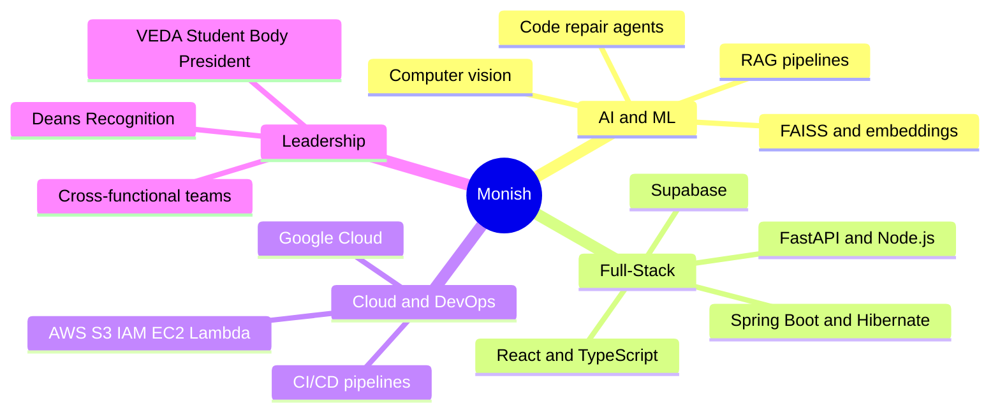
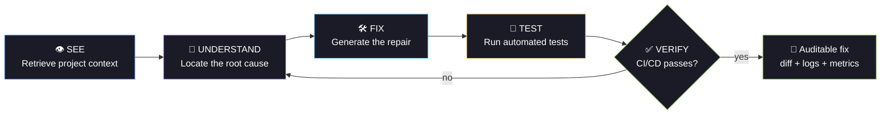
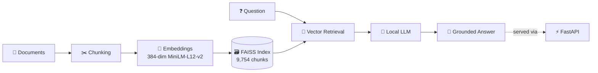
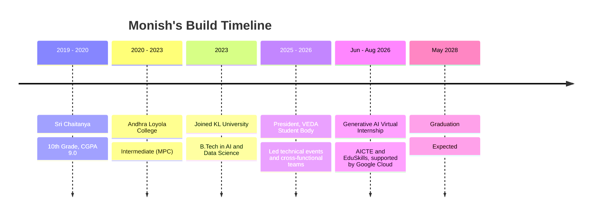

<p align="center">
  
</p>

<p align="center">
  <a href="https://git.io/typing-svg">
    
  </a>
</p>

<p align="center">
  
  <a href="https://github.com/Monish03905?tab=followers"></a>
  
</p>

<p align="center">
  <a href="https://www.linkedin.com/in/monish-ratan-259695247/"></a>
  <a href="https://leetcode.com/u/KL2400080018/"></a>
  <a href="https://www.codechef.com/"></a>
  <a href="mailto:monish03905@gmail.com"></a>
</p>

---

## ⚡ `boot sequence`

```console
monish@vijayawada:~$ ./boot_profile.sh

[ OK ] Loading identity .............. Seelam Monish Ratan
[ OK ] Mounting education ............ B.Tech AI & Data Science · KL University · May 2028
[ OK ] Reading CGPA .................. 8.34 / 10
[ OK ] Indexing knowledge ............ 9,754 chunks in FAISS
[ OK ] Calibrating controls .......... 6-DOF, by bare hands
[ OK ] Checking deployments .......... 3 live apps
[ OK ] Verifying credentials ......... 5 cloud & AI certifications
[ OK ] Mission ....................... ship things that work

>> System ready. Awaiting your next big idea_
```

---

## 🪪 `player_card`

<table>
<tr>
<td align="center" width="20%"><h2>8.34</h2><sub>CGPA<br/>B.Tech AI & DS</sub></td>
<td align="center" width="20%"><h2>9,754</h2><sub>chunks indexed<br/>in FAISS</sub></td>
<td align="center" width="20%"><h2>6-DOF</h2><sub>gesture-flown<br/>drone</sub></td>
<td align="center" width="20%"><h2>3</h2><sub>live deployed<br/>apps</sub></td>
<td align="center" width="20%"><h2>5</h2><sub>cloud & AI<br/>certifications</sub></td>
</tr>
</table>

```json
{
  "name": "Seelam Monish Ratan",
  "role": "AI & Data Science undergraduate · Builder",
  "university": "KL University (KLEF)",
  "location": "Vijayawada, Andhra Pradesh, India",
  "philosophy": "I learn by building, and I like AI that takes part in real engineering workflows instead of just generating answers.",
  "currently_building": ["DeVision", "OpsGuard"],
  "currently_learning": ["AI agents", "RAG", "System design", "AWS & CI/CD"],
  "leadership": "Ex-President, VEDA Student Body (2025–26)",
  "looking_for": "AI/ML, software engineering or full-stack internship",
  "fun_fact": "I like turning ideas into complete, working systems"
}
```

---

## 🧭 `the_big_picture`



---

## 🚀 `active_missions`

<table>
<tr>
<td width="50%" valign="top">

### 🧠 DeVision
**Autonomous Code Repair & Verification Engine**

`See → Understand → Fix → Test → Verify`


[📦 Code](https://github.com/Monish03905/DeVision) · 🌐 Live demo

</td>
<td width="50%" valign="top">

### 🛡️ OpsGuard
**Real-Time Incident Response Platform**

`SLA monitoring · Incidents · Playbooks`


[📦 Code](https://github.com/Monish03905/OpsGuard) · 🌐 Live demo

</td>
</tr>
</table>

### 🔁 How DeVision thinks



---

## 🗂️ `mission_log` (click to expand)

<details>
<summary><b>📚 AURA-RAG — Multilingual Retrieval-Augmented Generation</b> &nbsp;·&nbsp; <code>Python</code> <code>FAISS</code> <code>FastAPI</code></summary>
<br>

A document-to-answer pipeline that answers questions in context, across languages.



| | |
|---|---|
| **Embeddings** | `paraphrase-multilingual-MiniLM-L12-v2`, 384 dimensions |
| **Index** | 9,754 document chunks in FAISS |
| **Serving** | FastAPI endpoint wired to a local generation model |
| **Stack** | `Python` `FAISS` `Sentence Transformers` `Hugging Face` `FastAPI` |

</details>

<details>
<summary><b>🧠 DeVision — Autonomous Code Repair & Verification Engine</b> &nbsp;·&nbsp; <code>TypeScript</code> <code>Vite</code> <code>CI/CD</code></summary>
<br>

An AI software engineering platform built so every fix can be audited.

- 🔍 Project-context retrieval
- 🛠️ Automated code-repair workflows
- 🧪 Automated test execution
- 🔄 Side-by-side original vs fixed code comparison
- ⚙️ CI/CD execution with live build logs and verification status
- 📊 Live CPU, memory, execution-time and compute-cost metrics

</details>

<details>
<summary><b>🛡️ OpsGuard — Real-Time Incident Response & Operations Platform</b> &nbsp;·&nbsp; <code>TypeScript</code> <code>Vite</code> <code>Supabase</code></summary>
<br>

- 📡 Real-time SLA monitoring
- 🚨 Incident tracking and management
- 👥 Team management and coordination
- 📋 Playbook-driven operational response
- 🔐 Quality gates: automated linting, testing, production builds and security checks

</details>

<details>
<summary><b>🚁 Gesture-Driven 3D Drone Simulator</b> &nbsp;·&nbsp; <code>Python</code> <code>OpenCV</code> <code>MediaPipe</code> <code>PyOpenGL</code></summary>
<br>

Fly a simulated drone with bare hands. No keyboard, no joystick, just a webcam.

| Gesture control | Visualization layer |
|---|---|
| 🛫 Takeoff / landing | 🌀 Animated propellers |
| ↔️ Translation | 📟 Live telemetry |
| 🔄 Yaw and pitch | 🧭 Radar and compass overlays |
| ⏸️ Hover / lock | 🎮 Real-time OpenGL scene |
| 🛑 Emergency stop | 📷 Real-time hand tracking |

</details>

<details>
<summary><b>🏥 Student Health & Wellness Tracking System</b> &nbsp;·&nbsp; <code>React</code> <code>TypeScript</code> <code>Spring Boot</code> <code>Hibernate</code></summary>
<br>

A full-stack, publicly deployed platform for tracking physical and mental wellness.

- 😴 Tracks sleep, hydration, energy, nutrition, activities and personal records
- 📊 Wellness dashboards and campus events
- 🥗 Nutrition planning
- 🫂 Anonymous peer support
- 📍 Care-location discovery
- 🚑 Emergency SOS
- ⚙️ Responsive React UI → Spring Boot REST APIs → Hibernate on MySQL / PostgreSQL

</details>

<details>
<summary><b>☁️ AWS S3 Batch Retagging — Cloud Storage Automation</b> &nbsp;·&nbsp; <code>AWS S3</code> <code>IAM</code> <code>PowerShell</code></summary>
<br>

- 📑 Bulk object tagging driven by a CSV manifest and an S3 Batch Operations job
- 🔑 IAM service roles, completion reports
- ♻️ Tag-filtered lifecycle rule moving objects to Standard-IA after 30 days
- ✅ Validated missing-object failure reporting and retry handling on a test set

</details>

<details>
<summary><b>🎨 The Tribal Handicrafts Hub</b> &nbsp;·&nbsp; <code>HTML</code> <code>CSS</code> <code>JavaScript</code></summary>
<br>

A web platform showcasing tribal handicrafts.

</details>

### 📌 Live Repo Cards

<p align="center">
  <a href="https://github.com/Monish03905/DeVision">
    
  </a>
  <a href="https://github.com/Monish03905/OpsGuard">
    
  </a>
</p>
<p align="center">
  <a href="https://github.com/Monish03905/Building-a-Student-Health-Wellness-Tracking-System-using-React-Spring-Boot">
    
  </a>
  <a href="https://github.com/Monish03905/FEDF-Project">
    
  </a>
</p>

---

## 🌳 `skill_tree`

| Branch | Unlocked skills |
|---|---|
| 🧠 **AI / ML & Vision** | `RAG` `FAISS` `Sentence Transformers` `Hugging Face` `OpenCV` `MediaPipe` `PyOpenGL` `Oracle AI Agent Studio` |
| 💻 **Languages** | `Java` `Python` `C++` `C` `JavaScript` `TypeScript` `SQL` `HQL` |
| ⚙️ **Backend** | `Spring Boot` `FastAPI` `Node.js` `REST APIs` `Hibernate` `Maven` |
| 🎨 **Frontend** | `React` `TypeScript` `Vite` `HTML` `CSS` `JavaScript` |
| 🗄️ **Data** | `MySQL` `PostgreSQL` `Supabase` |
| ☁️ **Cloud & DevOps** | `AWS (EC2, S3, Lambda, IAM, S3 Batch Ops)` `Google Cloud` `CI/CD` `Git` `GitHub Actions` `PowerShell` |
| 🧩 **Core concepts** | `DSA` `OOP` `System Design` `API Integration` `Software Testing` `Big Data Architectures` |

<p align="center">
  
  
  
  
  
  
  
</p>
<p align="center">
  
  
  
  
  
  
  
</p>
<p align="center">
  
  
  
  
  
  
  
  
  
</p>

---

## 🧗 `journey`



> **🧪 Generative AI Virtual Internship** · AICTE & EduSkills, supported by Google Cloud · Jun–Aug 2026 · 8 weeks
> Hands-on exposure to Generative AI and cloud-based AI technologies through the AICTE National Internship Portal.

---

## 🏆 `achievements_unlocked`

| Badge | Achievement |
|:---:|---|
| ☁️ | **AWS Certified Cloud Practitioner** |
| 🤖 | **Oracle Certified AI Foundations Associate** (Oracle Cloud Infrastructure) |
| 🧬 | **Oracle Agentic AI Certified Foundations Associate** |
| 🛠️ | **Oracle Fusion AI Agent Studio Certified Foundations Associate** |
| ⚙️ | **RPA Essentials**, Automation Anywhere |
| ⭐ | **4-Star Programmer** on CodeChef |
| 🏛️ | **Ex-President, VEDA Student Body** (2025–26) |
| 🏅 | **Dean's Recognition** for event management and coordination at collegiate festivals |

<p align="center">
  
</p>

---

## 🧩 `competitive_arena`

Active on **LeetCode · CodeChef · HackerRank · HackerEarth · Codeforces**, with a focus on data structures and dynamic programming.

<p align="center">
  <a href="https://leetcode.com/u/KL2400080018/">
    
  </a>
</p>

---

## 📊 `github_analytics`

<p align="center">
  
  
</p>

<p align="center">
  
</p>

<p align="center">
  
</p>

<p align="center">
  
</p>

---

## 🔭 `roadmap`

```text
Artificial Intelligence   ████████████░░░░  AI Agents → RAG → Computer Vision
Software Engineering      ████████████░░░░  Full-Stack → APIs → System Design
Cloud Engineering         ██████████░░░░░░  AWS → CI/CD → Scalable Systems
```

---

## 📬 `connect`

```console
monish@vijayawada:~$ ping --collab "AI + software engineering"

64 bytes from monish: reply=open  time=0ms
```

I'm looking for an **AI/ML, software engineering or full-stack internship** where I can keep shipping, and I'm open to collaborating on AI + software engineering projects.

📧 [monish03905@gmail.com](mailto:monish03905@gmail.com) &nbsp;·&nbsp; 💼 [LinkedIn](https://www.linkedin.com/in/monish-ratan-259695247/) &nbsp;·&nbsp; 💻 [GitHub](https://github.com/Monish03905) &nbsp;·&nbsp; 🧩 [LeetCode](https://leetcode.com/u/KL2400080018/)

<p align="center">
  
</p>

<p align="center"><i>"Build things that matter. Ship things that work."</i></p>
