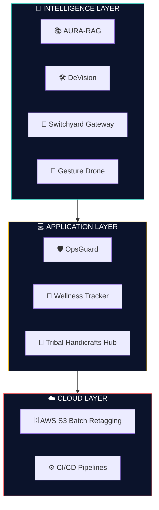
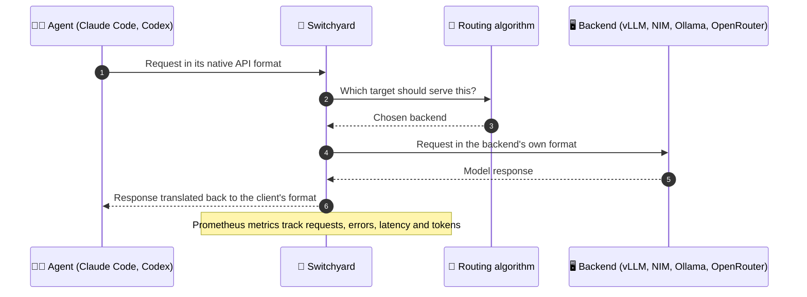
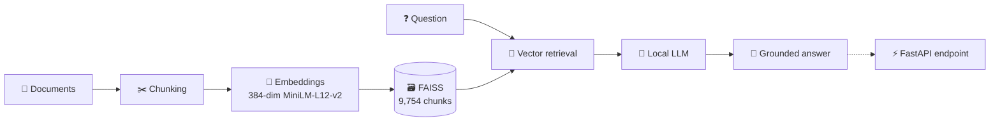
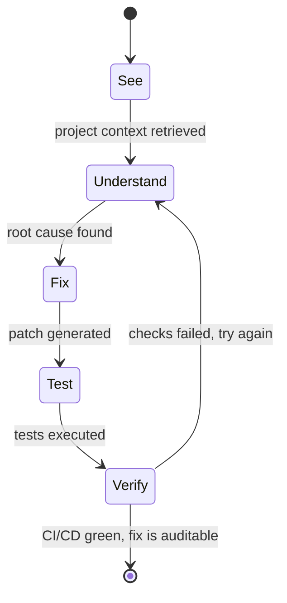
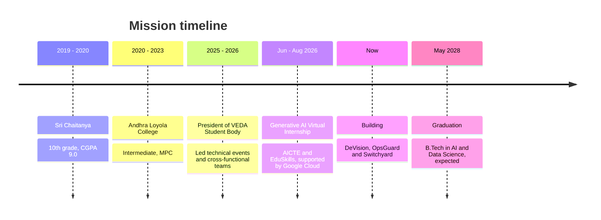

<p align="center">
  
</p>

<p align="center">
  
</p>

<p align="center">
  
  
  
  
</p>

<p align="center">
  <a href="https://www.linkedin.com/in/monish-ratan-259695247/"></a>
  <a href="mailto:monish03905@gmail.com"></a>
  <a href="https://leetcode.com/u/KL2400080018/"></a>
  <a href="https://www.codechef.com/"></a>
</p>

---

## 📡 TELEMETRY

<table>
<tr>
<td align="center" width="20%"><h1>8.34</h1><b>CGPA</b><br/><sub>B.Tech AI & DS</sub></td>
<td align="center" width="20%"><h1>9,754</h1><b>CHUNKS</b><br/><sub>indexed in FAISS</sub></td>
<td align="center" width="20%"><h1>6-DOF</h1><b>DRONE</b><br/><sub>flown by hand gestures</sub></td>
<td align="center" width="20%"><h1>7</h1><b>PROJECTS</b><br/><sub>3 live deployed apps</sub></td>
<td align="center" width="20%"><h1>5</h1><b>CERTS</b><br/><sub>cloud & AI</sub></td>
</tr>
</table>

---

## 🧑‍🚀 OPERATOR PROFILE

```text
┌──────────────────────────────────────────────────────────────────┐
│  OPERATOR   Seelam Monish Ratan                                  │
│  CLASS      AI & Data Science undergraduate · KL University      │
│  ETA        Graduation, May 2028                                 │
│  CREED      I learn by building. I want AI that takes part in    │
│             real engineering work, not just chat answers.        │
│  PAST ROLE  President, VEDA Student Body (2025-26)               │
│  ACTIVE     DeVision · OpsGuard · Switchyard LLM Gateway         │
│  LEARNING   AI agents · RAG · system design · AWS · CI/CD        │
│  SEEKING    AI/ML · software engineering · full-stack internship │
└──────────────────────────────────────────────────────────────────┘
```

---

## 🛰️ SYSTEM MAP

Everything I build sits on one of three layers.



---

## 🚀 ACTIVE MODULES

<table>
<tr>
<td width="33%" valign="top">

### 🚉 Switchyard
**LLM Gateway & Router**

Route LLM traffic across models and providers, with OpenAI and Anthropic API formats translated on the fly.


[📦 Repository](https://github.com/Monish03905/switchyard-llm-gateway)

</td>
<td width="33%" valign="top">

### 🧠 DeVision
**Autonomous Code Repair & Verification**

`See → Understand → Fix → Test → Verify`


[📦 Repository](https://github.com/Monish03905/DeVision) · 🌐 Live demo

</td>
<td width="33%" valign="top">

### 🛡️ OpsGuard
**Real-Time Incident Response**

SLA monitoring · incidents · playbooks · quality gates


[📦 Repository](https://github.com/Monish03905/OpsGuard) · 🌐 Live demo

</td>
</tr>
</table>

---

## 🚉 DEEP DIVE: SWITCHYARD LLM GATEWAY

An LLM agent speaks one API. The model you want to use speaks another. Switchyard sits in the middle, decides **which backend should answer**, and translates in both directions, so the agent never notices.



| 🧭 Routing strategy | What it does |
|---|---|
| 🎲 **Random split** | Spreads traffic across models, handy for A/B benchmarking |
| 🧠 **LLM classifier** | Reads the request and decides whether it needs a weak or a strong model |
| 🪜 **Escalation** | Starts on the cheap tier, then a judge decides whether to retry on the strong one |
| 🎛️ **Stage / custom** | Signal-driven stage routing, or your own algorithm |

| 🔌 Protocols translated | 🏃 Run it as |
|---|---|
| OpenAI Chat Completions | A standalone proxy server |
| OpenAI Responses | A launcher for coding agents |
| Anthropic Messages | An embedded Rust library |

**Why it matters:** flexible model selection, benchmarking and cost/performance tuning without rewriting a single client.

[📦 View the repository](https://github.com/Monish03905/switchyard-llm-gateway)

---

## 🗂️ MODULE ARCHIVE

<details>
<summary><b>📚 AURA-RAG</b> · Multilingual Retrieval-Augmented Generation · <code>Python</code> <code>FAISS</code> <code>FastAPI</code></summary>
<br>



- 🌍 Multilingual embeddings with `paraphrase-multilingual-MiniLM-L12-v2`
- 🗃️ 9,754 document chunks indexed in FAISS
- ⚡ FastAPI service connecting retrieval to a local generation model

</details>

<details>
<summary><b>🧠 DeVision</b> · Autonomous Code Repair & Verification Engine · <code>TypeScript</code> <code>Vite</code> <code>CI/CD</code></summary>
<br>



- 🔄 Side-by-side original vs fixed code comparison
- ⚙️ CI/CD execution with live build logs and verification status
- 📊 Live CPU, memory, execution-time and compute-cost metrics

</details>

<details>
<summary><b>🛡️ OpsGuard</b> · Real-Time Incident Response Platform · <code>TypeScript</code> <code>Vite</code> <code>Supabase</code></summary>
<br>

- 📡 Real-time SLA monitoring
- 🚨 Incident tracking and team coordination
- 📋 Playbook-driven operational response
- 🔐 Quality gates: linting, tests, production builds and security checks

</details>

<details>
<summary><b>🚁 Gesture-Driven 3D Drone Simulator</b> · <code>Python</code> <code>OpenCV</code> <code>MediaPipe</code> <code>PyOpenGL</code></summary>
<br>

No keyboard, no joystick. Just a webcam and your hands.

| ✋ Gesture control | 🖥️ Cockpit display |
|---|---|
| 🛫 Takeoff and landing | 🌀 Animated propellers |
| ↔️ Translation | 📟 Live telemetry |
| 🔄 Yaw and pitch | 🧭 Radar and compass overlays |
| ⏸️ Hover lock | 🎮 Real-time OpenGL scene |
| 🛑 Emergency stop | 📷 Real-time hand tracking |

</details>

<details>
<summary><b>🏥 Student Health & Wellness Tracker</b> · <code>React</code> <code>TypeScript</code> <code>Spring Boot</code> <code>Hibernate</code></summary>
<br>

A publicly deployed full-stack platform: **React → Spring Boot REST → Hibernate → MySQL / PostgreSQL**.

- 😴 Tracks sleep, hydration, energy, nutrition and activities
- 📊 Wellness dashboards and campus events
- 🥗 Nutrition planning
- 🫂 Anonymous peer support
- 📍 Care-location discovery
- 🚑 Emergency SOS

</details>

<details>
<summary><b>☁️ AWS S3 Batch Retagging</b> · <code>AWS S3</code> <code>IAM</code> <code>PowerShell</code></summary>
<br>

- 📑 CSV manifest drives an S3 Batch Operations tagging job
- 🔑 IAM service roles and completion reports
- ♻️ Tag-filtered lifecycle rule moving objects to Standard-IA after 30 days
- ✅ Validated missing-object failure reporting and retry handling

</details>

<details>
<summary><b>🎨 The Tribal Handicrafts Hub</b> · <code>HTML</code> <code>CSS</code> <code>JavaScript</code></summary>
<br>

A web platform showcasing tribal handicrafts.

</details>

### 📌 Pinned repos

<p align="center">
  <a href="https://github.com/Monish03905/switchyard-llm-gateway"></a>
  <a href="https://github.com/Monish03905/DeVision"></a>
</p>
<p align="center">
  <a href="https://github.com/Monish03905/OpsGuard"></a>
  <a href="https://github.com/Monish03905/Building-a-Student-Health-Wellness-Tracking-System-using-React-Spring-Boot"></a>
</p>

---

## 🧰 TOOLKIT

| Bay | Gear |
|---|---|
| 🧠 **AI / ML & Vision** | `RAG` `FAISS` `Sentence Transformers` `Hugging Face` `OpenCV` `MediaPipe` `PyOpenGL` `Oracle AI Agent Studio` |
| 💻 **Languages** | `Java` `Python` `C++` `C` `JavaScript` `TypeScript` `SQL` `HQL` |
| ⚙️ **Backend** | `Spring Boot` `FastAPI` `Node.js` `REST APIs` `Hibernate` `Maven` |
| 🎨 **Frontend** | `React` `TypeScript` `Vite` `HTML` `CSS` |
| 🗄️ **Data** | `MySQL` `PostgreSQL` `Supabase` |
| ☁️ **Cloud & DevOps** | `AWS: EC2, S3, Lambda, IAM, S3 Batch Ops` `Google Cloud` `CI/CD` `Git` `GitHub Actions` `PowerShell` |
| 🧩 **Foundations** | `Data Structures & Algorithms` `OOP` `System Design` `API Integration` `Software Testing` |

<p align="center">
  
</p>

---

## 🧭 FLIGHT LOG



> **🧪 Generative AI Virtual Internship** · AICTE & EduSkills, supported by Google Cloud · Jun to Aug 2026 · 8 weeks
> Practical exposure to Generative AI and cloud-based AI technologies.

---

## 🏅 MEDALS

| | Credential |
|:---:|---|
| ☁️ | **AWS Certified Cloud Practitioner** |
| 🤖 | **Oracle Certified AI Foundations Associate** (OCI) |
| 🧬 | **Oracle Agentic AI Certified Foundations Associate** |
| 🛠️ | **Oracle Fusion AI Agent Studio Certified Foundations Associate** |
| ⚙️ | **RPA Essentials** (Automation Anywhere) |
| ⭐ | **4-Star programmer** on CodeChef |
| 🏛️ | **Ex-President, VEDA Student Body** (2025-26) |
| 🎖️ | **Dean's Recognition** for event management and coordination |

<p align="center">
  
</p>

---

## 🧩 ARENA

Competing on **LeetCode · CodeChef · HackerRank · HackerEarth · Codeforces**, mostly data structures and dynamic programming.

<p align="center">
  <a href="https://leetcode.com/u/KL2400080018/"></a>
</p>

---

## 📊 GITHUB INSTRUMENTS

<p align="center">
  
  
</p>

<p align="center">
  
</p>

<p align="center">
  
</p>

<p align="center">
  <picture>
    <source media="(prefers-color-scheme: dark)" srcset="https://raw.githubusercontent.com/Monish03905/Monish03905/output/github-snake-dark.svg" />
    <source media="(prefers-color-scheme: light)" srcset="https://raw.githubusercontent.com/Monish03905/Monish03905/output/github-snake.svg" />
    
  </picture>
</p>

---

## 🔭 NEXT DESTINATIONS

```text
AI Agents        ████████████░░░░  agents, tool use, RAG
LLM Infra        ███████████░░░░░  routing, gateways, observability
System Design    ██████████░░░░░░  scalable backends and APIs
Cloud & CI/CD    ██████████░░░░░░  AWS, pipelines, deployment
```

---

## 📞 OPEN A CHANNEL

I'm looking for an **AI/ML, software engineering or full-stack internship** where I can keep shipping, and I'm happy to collaborate on AI and software projects.

<p align="center">
  <a href="mailto:monish03905@gmail.com"></a>
  <a href="https://www.linkedin.com/in/monish-ratan-259695247/"></a>
</p>

<p align="center">
  
</p>

<p align="center"><i>Build things that matter. Ship things that work.</i></p>
