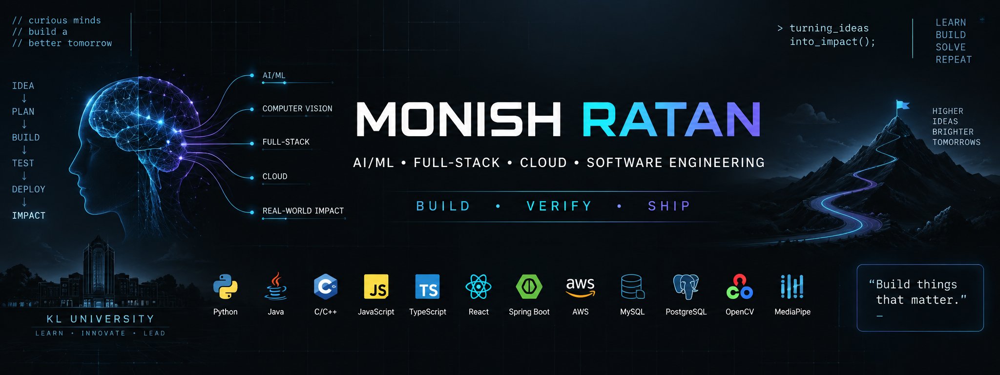

<p align="center">
  
</p>

<p align="center">
  <a href="https://git.io/typing-svg">
    
  </a>
</p>

<p align="center">
  
  <a href="https://github.com/Monish03905?tab=followers"></a>
  
</p>

<p align="center">
  <a href="https://www.linkedin.com/in/monish-ratan-259695247/"></a>
  <a href="https://leetcode.com/u/KL2400080018/"></a>
  <a href="https://www.codechef.com/"></a>
</p>

---

## 👨‍💻 About Me

I build practical software at the intersection of **AI, full-stack engineering, computer vision and cloud**, especially systems where AI takes part in real engineering workflows instead of just generating answers.

| | |
|---|---|
| 🎓 **Education** | B.Tech — AI & Data Science, KL University |
| 📍 **Location** | Vijayawada, Andhra Pradesh, India |
| 🔭 **Currently building** | DeVision & OpsGuard |
| 🌱 **Learning** | AI agents, RAG, system design, AWS & CI/CD |
| 🏛️ **Leadership** | Former President, VEDA Student Body |
| ⚡ **Fun fact** | I like turning ideas into complete, working systems |

---

## 🚀 What I'm Building

<table>
<tr>
<td width="50%" valign="top">

### 🧠 DeVision
**Autonomous Code Repair & Verification Engine**

`See → Understand → Fix → Test → Verify`


</td>
<td width="50%" valign="top">

### 🛡️ OpsGuard
**Real-Time Incident Response Platform**

SLA monitoring • Incidents • Playbooks


</td>
</tr>
</table>

---

## 🔥 Featured Projects

> 👇 Click any project to expand it

<details>
<summary><b>🧠 DeVision — Autonomous Code Repair & Verification Engine</b></summary>
<br>

An AI software engineering platform built on a five-stage verification loop: **See → Understand → Fix → Test → Verify**.

- 🔍 Project-context retrieval
- 🛠️ Automated code repair workflows
- 🧪 Automated test execution
- 🔄 Original vs fixed code comparison
- ⚙️ CI/CD execution
- 📊 Live build metrics: CPU, memory and execution time

**Stack:** `TypeScript` `Vite` `CI/CD`

</details>

<details>
<summary><b>🛡️ OpsGuard — Real-Time Incident Response Platform</b></summary>
<br>

A real-time operations platform for incident response and service reliability.

- 📡 SLA monitoring
- 🚨 Incident management
- 👥 Team coordination
- 📋 Operational playbooks
- 🧪 Automated testing and 🔐 security checks

**Stack:** `TypeScript` `Vite` `Supabase`

</details>

<details>
<summary><b>🚁 Gesture-Driven 3D Drone Simulator</b></summary>
<br>

Control a simulated drone with hand gestures using real-time webcam processing.

- 🚁 6-DOF control: takeoff/landing, translation, yaw/pitch
- ⏸️ Hover / lock
- 🛑 Emergency stop
- 📷 Real-time hand tracking

**Stack:** `Python` `OpenCV` `MediaPipe` `PyOpenGL`

</details>

<details>
<summary><b>🏥 Student Health & Wellness Tracking System</b></summary>
<br>

A full-stack platform for students to track physical and mental wellness and keep digital records.

- 🌐 Responsive React frontend
- ⚙️ Spring Boot REST APIs
- 🗄️ Hibernate data management on MySQL / PostgreSQL

**Stack:** `React` `TypeScript` `Java` `Spring Boot` `Hibernate` `MySQL` `PostgreSQL`

</details>

<details>
<summary><b>🎨 The Tribal Handicrafts Hub</b></summary>
<br>

A web platform showcasing tribal handicrafts.

**Stack:** `HTML` `CSS` `JavaScript`

</details>

### 📌 Live Repo Cards

<p align="center">
  <a href="https://github.com/Monish03905/Building-a-Student-Health-Wellness-Tracking-System-using-React-Spring-Boot">
    
  </a>
  <a href="https://github.com/Monish03905/FEDF-Project">
    
  </a>
</p>
<p align="center">
  <a href="https://github.com/Monish03905/DeVision">
    
  </a>
  <a href="https://github.com/Monish03905/OpsGuard">
    
  </a>
</p>

---

## 🛠️ Tech Stack

<details open>
<summary><b>Languages</b></summary>
<br>


</details>

<details open>
<summary><b>Full-Stack</b></summary>
<br>


</details>

<details open>
<summary><b>AI / Computer Vision</b></summary>
<br>


</details>

<details open>
<summary><b>Databases & Cloud / DevOps</b></summary>
<br>


</details>

---

## 🏆 Achievements & Certifications

<details>
<summary><b>Click to view certifications</b></summary>
<br>

- ☁️ **AWS Certified Cloud Practitioner**
- 🤖 **Oracle Certified AI Foundations Associate**
- 🤖 **Oracle Fusion AI Agent Studio Certified Foundations Associate**
- 🧠 **Oracle Agentic AI Certified Foundations Associate**
- ⚙️ **RPA Essentials — Automation Anywhere**

</details>

| Achievement | Details |
|---|---|
| ⭐ Competitive Programming | **4-Star — CodeChef** |
| 🏛️ Leadership | Former President — **VEDA Student Body** |
| 🏅 Recognition | Dean's Recognition for event management & coordination |

<p align="center">
  
</p>

---

## 📊 GitHub Analytics

<p align="center">
  
  
</p>

<p align="center">
  
</p>

<p align="center">
  
</p>

<p align="center">
  
</p>

---

## 🧩 Competitive Programming

<p align="center">
  <a href="https://leetcode.com/u/KL2400080018/">
    
  </a>
</p>

---

## 💡 Areas I'm Exploring

```text
Artificial Intelligence     →  AI Agents → RAG → Computer Vision
Software Engineering        →  Full-Stack → APIs → System Design
Cloud Engineering           →  AWS → CI/CD → Scalable Systems
```

---

## 📬 Let's Connect

I'm open to collaborating on AI + software engineering projects. Reach out on [LinkedIn](https://www.linkedin.com/in/monish-ratan-259695247/).

<p align="center">
  
</p>

<p align="center"><i>"Build things that matter. Ship things that work."</i></p>
